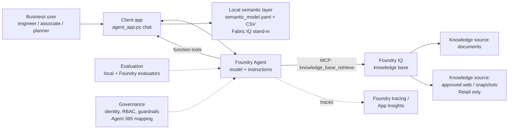

# 01 · Reference architecture

Use this as the starting point for your Day 1 architecture outline. Adapt it to your use case. Don't copy it blindly: the panel asks *why* you made each choice.

## Logical view

## Request flow (one combined question)

1. The user asks: *"Why did HX-220 porosity spike in September, and what should we do?"*
2. The **agent** (model + your instructions) plans: it needs metrics *and* procedures and prior cases.
3. It calls **`query_metrics`** (a function tool). `agent_app.py` runs it against the local semantic layer and returns rows plus a `citation` like `semantic://manufacturing_quality/defect_rate_ppm?by=week_start&part_number="HX-220"`.
4. It calls **`knowledge_base_retrieve`** (MCP tool) on **Foundry IQ**. The knowledge base plans subqueries, searches the document index, reranks and returns passages with source references.
5. The agent writes a **structured, cited answer**: the hypothesis, data evidence (with semantic citations), document evidence (with document citations), recommended actions, and confidence and limits.
6. Every step is **traced** in Foundry. The test set is replayed and **evaluated** (Day 3).

## Component choices and the reasoning to defend

| Decision | Default in this kit | Alternatives you could argue for |
|---|---|---|
| Agent hosting | Foundry **prompt agent** (server-side definition, versioned) | Hosted agent (container); Agent Framework in code |
| Doc grounding | Foundry IQ **knowledge base** over a blob or file knowledge source | Search-index knowledge source with your own chunking; SharePoint source |
| Retrieval effort | `low` (query planning on) | `minimal` (cheaper and faster, weaker on multi-part questions); `medium` |
| Structured data | Function tools over a **governed semantic model** | Code Interpreter over CSVs (no governed definitions, harder to audit); real Fabric IQ data agent / ontology knowledge source |
| Why not let the model write SQL? | Governed measures mean "defect rate" is always the same formula; the tool is read-only and parameterised | Text-to-SQL: flexible, but riskier and harder to evaluate |
| Citations | Document references from Foundry IQ + `semantic://` citations from tools | |
| Evaluation | Ground-truth checks + Foundry groundedness, relevance and task adherence | Custom evaluators, red-teaming |

## Mapping the lab to the target production architecture

| Lab component | Production target | What changes |
|---|---|---|
| Local semantic layer (CSV + YAML) | **Fabric IQ**: semantic model / ontology / data agent on OneLake | Replace the three function tools with the Fabric data agent tool, or a Fabric Ontology knowledge source in the same Foundry IQ knowledge base. Measure definitions move into the semantic model. |
| `agent_app.py` running function tools on your VM | A hosted backend (Azure Functions / Container Apps) behind an OpenAPI tool, or Fabric | Tools execute server-side; no client loop |
| Web snapshots (Retail) | Foundry IQ Web knowledge source (Bing) with allow-list | Admin enables Web Knowledge Source; snapshots kept as fallback |
| Governance design doc | **Agent 365**: agent registry, identity, access policies, observability | Register the agent, apply access policies, use Agent 365 audit views |
| Single user (you) | Entra-authenticated users, per-user permission trimming (`x-ms-query-source-authorization`) | Add OBO tokens; document-level ACLs |

## Non-functional considerations (bring these to the panel)

- **Security:** managed identities and RBAC, no keys in code; read-only tools; least privilege on search; content safety guardrails.
- **Data boundary:** Web grounding sends queries outside the Azure compliance boundary (say this for Retail).
- **Cost:** retrieval reasoning effort, model choice and the number of tool calls per answer drive cost. Measure latency and tokens in your evaluation run.
- **Scalability:** knowledge bases can be shared across agents; semantic definitions are reusable; scale search replicas for query load.
- **Operability:** versioned agents (each `deploy` creates a new version), traces, evaluation as a regression gate before promoting a version.
